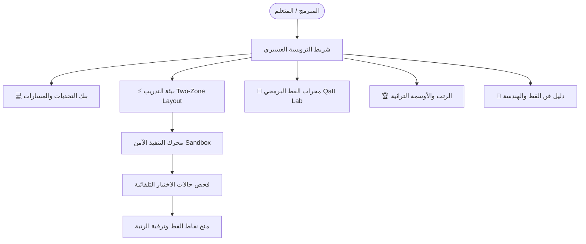

# 🎨 قطّاط البرمجة — Qattat Code

> **منصة التدريب البرمجي التفاعلية بطابع فن القط العسيري والتراث الجنوبي السعودي**  
> **Interactive Coding Training Platform Infused with Asiri Qatt Heritage**  
> **Author & Chief Architect:** 🏛️ أ. طارق ابوعشي — استشاري ومعماري هندسة البرمجيات والأنظمة الموزعة

[](https://github.com/Tareq0001/Qattat-Code/actions)
[](https://tareq0001.github.io/Qattat-Code/)

---

## 📌 نبذة عن المنصة (Overview)

**قطّاط البرمجة (Qattat Code)** هي منصة تدريب برمجية تفاعلية ثنائية اللغة تجمع بين تدريب المطورين على حل التحديات البرمجية في **بايثون (Python)** و**جافاسكريبت (JavaScript)** و**الخوارزميات وتراكيب البيانات (Algorithms)**، والاحتفاء بالهوية البصرية العسيرية الأصيلة المستوحاة من فن **"القط العسيري"** (المسجل في قائمة التراث الإنساني لليونسكو لعام 2017) عبر أنماطه الهندسية، ألوانه الطبيعية الخمسة، ونظام رتب وأوسمة تراثي متقن ومختبر لتوليد جداريات القط بالكود.



---

## 🏛️ العناصر الهندسية التراثية ومقابلاتها البرمجية

| العنصر التراثي | شكله الهندسي | المقابل البرمجي في هندسة الخوارزميات |
|---|---|---|
| **البَنَة (Al-Bana)** | مثلثات متقابلة ومتراكبة تمثل قمم الجبال | خوارزميات الاستدعاء الذاتي (Recursion)، الشجيرات الثنائية (Binary Trees)، والبرمجة الديناميكية التصاعدية |
| **المشط (Al-Misht)** | خطوط رأسية متوازية كأسنَان المشط | حلقات التكرار (Loops)، معالجة المصفوفات المتتالية (Arrays)، والتدفقات البرمجية (Streams) |
| **السكرانة (Al-Sakranah)** | مربعات ومعينات متناوبة تتلاعب بالضوء والظل | المنطق الثنائي (Bitwise Operations)، جداول الهاش (Hash Maps)، وكشف التناظر (Symmetry) |
| **المحاريب (Al-Maharib)** | أقواس وقباب تشبه محاريب المساجد وقلاع السراة | معمارية النطاقات (Domain Architecture)، العزل والكبسلة (Encapsulation)، وبوابات النظم (Gateways) |
| **الختام (Al-Khetam)** | الإطار المحيط بالجدارية الذي يضبط توازنها | قيود السلامة البرمجية (Boundary Conditions) واختبارات التكامل وحالات الاختبار الحدية |

---

## 🎨 الهوية البصرية ونظام الألوان (60-30-10 Palette)

- **الخلفية الأساسية (60%):** لون الجص الأبيض العسيري النقي `#FAF9F6` في الوضع الفاتح، والأسود الصخري العميق كحجر السراة `#121417` في الوضع الليلي.
- **الأسطح الهيكلية (30%):** حدود رفيعة للغاية (Hairline borders `#E5E0D8` / `#2D333F`)، بطاقات بيضاء دافئة مستوحاة من طين وبيوت عسير الحجرية.
- **ألوان القط الخمسة الطبيعية (10% ألوان تركيز وإجراءات):**
  - **الأحمر القاني (Asiri Crimson) `#C22B26`:** أزرار التنفيذ الأساسية والنقاط البارزة.
  - **الأصفر الشمسي (Ochre Gold) `#D97706` / `#E5A912`:** الأوسمة والنقاط والتقييمات.
  - **الأخضر البري (Flora Green) `#15803D`:** نجاح الاختبارات والإنجاز المكتمل.
  - **الأزرق النيلي (Indigo Blue) `#1D4ED8`:** تحديد المسارات وألسنة التبويب النشطة.
  - **الأسود الكاحل (Charcoal Black) `#18181B`:** التحديدات الهندسية للنقوش والأطر التراثية.

---

## ⚡ المزايا التقنية الأساسية للمنصة

1. **بيئة تدريب مهندمة (Two-Zone Layout):**
   - **المنطقة اليمنى:** وصف المسألة، الشروط والقيود، أمثلة توضيحية، 3 مستويات من التلميحات المتدرجة، وحلول نموذجية مع تحليل التعقيد الزمني والمكاني ($O(n)$, $O(1)$).
   - **المنطقة اليسرى:** محرر كود مع ترقيم أسطر حقيقي، دعم لغات بايثون وجافاسكريبت، كونسول مباشر، وفحص لحظي لحالات الاختبار.
2. **محرك فحص مباشر في المتصفح (Client-side Sandbox):**
   - تنفيذ فوري وآمن للأكواد بدون الحاجة لخوادم خارجية، مع حماية من الأخطاء وقياس زمن التنفيذ بالمللي ثانية.
3. **محراب القط البرمجي (Qatt Code Lab):**
   - مختبر تفاعلي لتوليد جداريات القط العسيري رياضياً بالكود مع التحكم في عدد الصفوف والأعمدة والتناظر وتصدير العمل الفني فورياً بصيغة SVG متجهة عالية الدقة.
4. **نظام رتب وأوسمة تراثي:**
   - 6 رتب تراثية تبدأ من "مبتدئ النقش" وتصل إلى "معلم القط البرمجي".
   - أوسمة تراثية بأيقونات هندسية تُفتح وفق شروط برمجية محددة.
   - حفظ تلقائي للتقدم والأكواد المحلولة عبر المتصفح (`localStorage`).

---

## 🧪 الاختبارات الآلية (Automated Testing)

تشغيل حزمة اختبارات الوحدة المعمارية:

```bash
node tests/qattat.test.js
```

### التغطية:
- ✔ سلامة واكتمال بنك التحديات البرمجية في بايثون وجافاسكريبت والخوارزميات.
- ✔ خوارزمية المقارنة العميقة للمخرجات (`isDeepEqual`).
- ✔ محرك الفحص البرمجي واجتياز الحلول النموذجية بنسبة 100%.
- ✔ المحرك الرياضي لتوليد جداريات الـ SVG.
- ✔ شروط فتح الأوسمة وترقية الرتب التراثية.

---

## 🌐 الرابط المباشر للمنصة (Live Deployment)

المنصة متاحة ومفعلة مباشرة على GitHub Pages:  
🔗 **[https://tareq0001.github.io/Qattat-Code/](https://tareq0001.github.io/Qattat-Code/)**

---

## 🏛️ حقوق الملكية والابتكار

تصميم وتطوير **أ. طارق ابوعشي** — جميع الحقوق محفوظة 2026.  
رخصة الاستخدام: MIT License.
